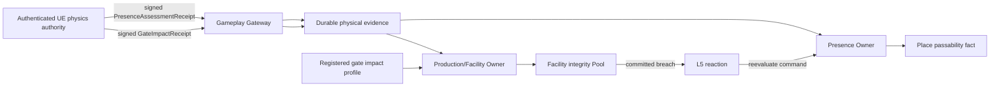
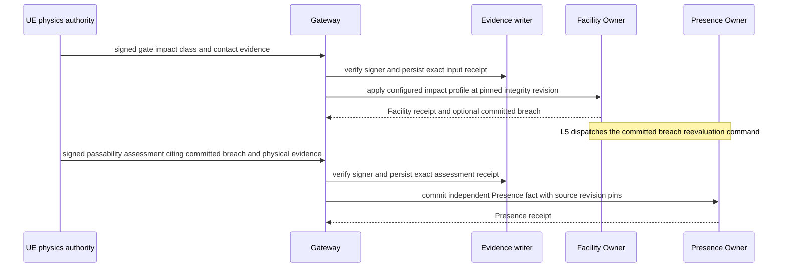
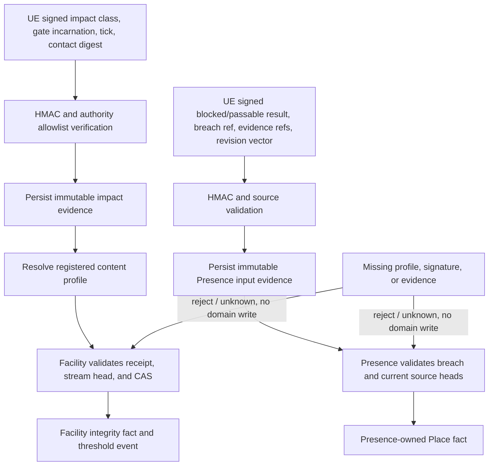

# M6-5 signed physical inputs and Owner writers

## Intent and boundary

Implement the formal `impact_gate` source path and the already selected Presence rule. UE supplies authenticated physical evidence. Server-side, versioned content maps an impact class to Facility input. Facility alone writes integrity Pool facts. UE supplies an independent signed Presence assessment after breach. Presence alone writes passability. Exact retries recover each stage without combining their receipts or facts.

`gate-03` impact values remain explicit content configuration. This unit does not infer damage from a client-supplied number, map breach to passability, or add facts to Combat, Organization, or LifeState.

## Approaches

1. Separate signed Gate impact and Presence assessment evidence events. Each domain Owner validates its own evidence and commits its own fact. This preserves the existing role-only PhysicsContactReceipt contract and models `impact_gate` as a cross-host obligation. Selected.
2. Extend the existing role-action contact receipt into a combined gate interaction receipt. This couples a character ActionAttempt to a gate and bundles two independently owned effects, while requiring compatibility changes to a persisted receipt contract.

## Ownership and modules

## Interaction order

## Data flow

## Constraints and open content

- Keep the existing `PhysicsContactReceipt` model, event type, reader behavior, and role-combat route unchanged.
- Persist Gate impact and Presence input as separate, signed, idempotent evidence events. Owner events remain separate.
- Carry source stream revisions into Owner commits so a changed source conflicts atomically.
- The gate content package must register the supported impact class and its delta. A missing mapping is a zero-write rejection.
- UE assessment must cite the committed breach plus at least one distinct Owner-verifiable event. Missing evidence remains unknown and writes no Place fact.
- Existing documentation gives no numerical gate impact deltas or UE assessment transport schema. The implementation uses required configuration and versioned receipt fields, and reports the absent runtime/configuration integration explicitly.
- Do not modify EventStore, gameplay models, economy/inventory shared boundaries, B-owned domains, or the read-only documentation repository.

## Planned implementation units

1. Add receipt models, verifier, immutable evidence writers, event-schema visibility and replay owner classification. Verify signatures, forgery rejection, exact retry, changed-receipt rejection, and checkpoint replay readers.
2. Add Facility impact input that resolves a server-owned profile mapping, pins the signed evidence revision, and writes only the Facility integrity Pool. Verify missing-profile, stale-revision, retry and breach behavior.
3. Add Presence evidence consumption and production Gateway entry. Verify its separate receipt, source ownership/revisions, zero-write unknown behavior, exact retry, L5 dispatch, and production callback wiring.

The production `main.py` change is pre-announced in `docs/v2-coordination/comms/2026-11-24-thread-a.md`. Each unit is independently committed and validated with its permanent selection, ownership frozen selection, and shared-replay frozen selection. Raw validation output is stored under a new directory on F:.

## Slice 1 result: signed durable input evidence

- Commits: `22bf06158969c4b7419a93a17654408a1c6b58ab` (evidence writer, schema visibility, replay participant) and `6cf4ea8613a2d8626c83371a020b5f890d2ca60d` (checkpoint manifest decoder registration).
- Both commits were checked in detached worktree `F:/codex-temp/m6-5-input-slice1-22bf0615` at `6cf4ea86`. Python was `3.12.2`; `app.__file__` resolved to `F:/codex-temp/m6-5-input-slice1-22bf0615/backend/app/__init__.py`.
- Targeted command ran `test_siege_physical_input_runtime.py`, `test_place_passability_runtime.py`, and `test_morale_refold_runtime.py`: **13 passed**.
- Frozen ownership selection: `selected=24 problems=0 improvements=0`.
- Frozen shared-replay selection: `selected=990 problems=2 improvements=0`. Both failures are `test_profile_repeated_in_one_run_receives_fresh_events[isolated-storage]` and `[wall-clock]`, each reports `Port 8000 is occupied by an external process without a healthy backend`. This matches the already recorded environment failure category. Raw batch JUnit and console output are at `F:/paralls-verification/thread-a/m6-5-input-slice1-6cf4ea86/`.
- The first detached check at `22bf0615`, before adding the decoder field, exposed 28 replay manifest scope failures plus the two Port 8000 failures. Registering the participant field/version fixed those 28 failures. The follow-up commit was checked with 50 replay tests, all passed, before re-running the frozen selection at `6cf4ea86`.
- No full suite was run for this slice. This verifies immutable input evidence, schema visibility and replay registration. It does not verify Facility/Presence production facts or an end-to-end siege playthrough.

## Slice 2 in progress: domain writers and Gateway

- Facility consumes a signed GateImpactReceipt, resolves only the server-provided impact profile, pins the input stream revision, and writes through the Facility-owned Pool. Missing profile or stale integrity revision is a zero-write rejection.
- Presence consumes a separately signed assessment receipt. The decision and its source events/revisions are included in the Place fact written by the Presence authority.
- The main application exposes signed Gate impact and Presence assessment HTTP input routes. Its existing `physics_contact_authority_secrets` configuration supplies receipt verification keys.
- The application has no registered production gate impact profile or Facility Pool initial/threshold configuration. Until those values are supplied by an authoritative content configuration, the HTTP Gate route records signed evidence and reports Facility `not_configured`. Test-only numeric values are not production tuning.
- Targeted validation for the in-progress slice currently reports 20 passed across `test_siege_physical_input_runtime.py`, `test_facility_integrity_runtime.py`, `test_place_passability_runtime.py`, and `test_m6_5_siege_runtime.py`. Detached/frozen-selection validation and commit are pending.
