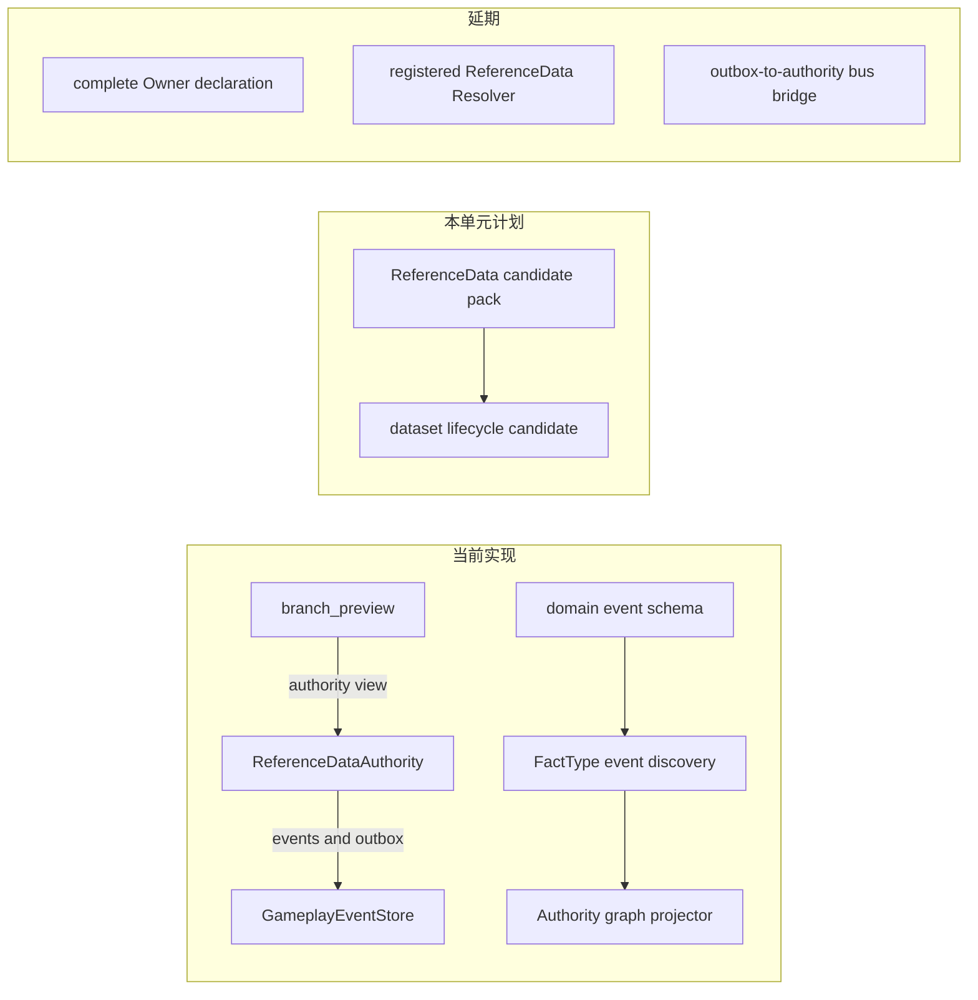
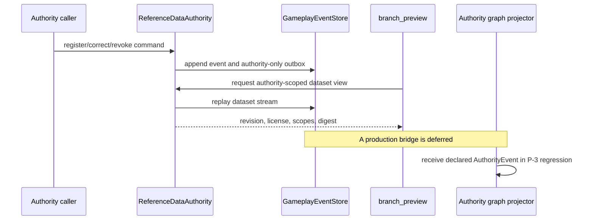
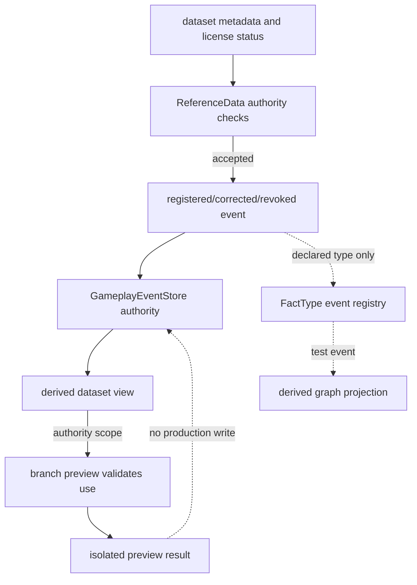

# ReferenceData 迁移设计

- 基线：`810a46c1249918c09b42fa1fe0c12d7d784579d2`（`integration-2026-11-23`）
- 扫描命令：`rg -n "ReferenceDataset|reference_data|dataset_ref|license_status|allowed_scopes|FrozenReferenceDatasetInput" backend/app backend/tests/test_infra_reference_data_license_admission.py backend/tests/test_infra_population_branch_preview.py backend/tests/test_world_prediction.py`；`rg -n "gameplay_schema_event_types|FACT_TYPE_REGISTRY|AuthorityGraphProjector" backend/app backend/tests`
- 扫描时间：2026-11-23 Asia/Shanghai
- 结论等级：事实项为已验证或仅静态，候选模型未裁定

## 事实清单

| 事实 | 生产位置与行为 | 候选归属 |
|---|---|---|
| 数据集登记、元数据更正、撤销 | `backend/app/gameplay/reference_data_runtime.py:71-85,107-136` 写 `dataset_registered`、`dataset_corrected`、`dataset_revoked`；每个 `dataset_ref` 有独立 `gameplay:reference_data:<dataset_ref>` stream | Information，候选。该规范短名在 `REGISTERED_OWNER_IDS` 登记，`backend/app/gameplay/fact_type_registry.py:11-34` |
| 数据集记录 | `reference_data_runtime.py:20-30` 含 provenance、license_ref、schema_revision、digest、classification、allowed_scopes、license_status；以上字段随登记/更正事件写入 | Information，候选。各字段是否为独立 FactType 尚未裁定 |
| 当前状态投影 | `reference_data_runtime.py:138-173` 从事件重建 revision、active/revoked、source refs/vector 和 digest，不存本地数据库状态 | Information，候选 |
| 许可/范围校验 | `backend/app/population_continuity/branch_preview.py:64-90,157-165` 校验来源 revision、digest、dataset ref、scopes、许可状态 | Information 拥有数据许可事实的候选；Population/Work 拥有 branch preview 执行事实的候选 |
| 预览不写生产流 | `backend/tests/test_infra_reference_data_license_admission.py:76-116` 断言已授权预览、撤销拒绝且事件数保持不变 | 读取方证据，已验证于已有测试源码，实际运行见本轮记录 |

## 候选 FactType 划分

规范要求 FactType 对应最小独立 revision 流，声明 primitive、identity、owner_ref、visibility、resolution_order、event_schema_ref 等字段（文档仓库 `docs/architecture-v2/03-事实类型/01-FactType定义.md` §一至§五）。以下只是候选，不是已裁定声明。

| 候选事实 | 候选短名 | 原语候选 | visibility 候选 | resolution_order 依据 |
|---|---|---|---|---|
| 数据集许可状态（permitted/restricted） | `fact:information:<dataset_ref>:license_status` | machine，推断。基线 validator 目前只接受 machine，`backend/app/gameplay/fact_type_registry.py:121-127` | private，推断；事件 outbox 标为 authority_only，runtime 只允许 `reader_scope="authority"`，`reference_data_runtime.py:87-97,134` | 暂列 unrelated。没有证据表明它必须先于另一 ReferenceData FactType 结算 |
| 数据集生命周期（active/revoked） | `fact:information:<dataset_ref>:dataset_status` | machine，推断 | private，推断，依据同上 | 暂列 unrelated。状态独立变化，未发现同一管线内的先后约束 |
| 来源、schema、digest、classification、allowed_scopes | 尚不确定能否由一个或多个 FactType 表达 | 暂不指定。现有 registry 仅支持 machine，无法据此合理裁成 pool 或其他原语 | authority-only 的候选，待可见性规范与读取者分类确定 | 暂不指定；信息字段随更正事件一起变化不证明其永不可分或必须共用 revision |

命名中的 `<dataset_ref>` 是说明性 scope 占位，不构成新的稳定短名或 owner_ref 语法。`owner_ref` 候选为规范短名 `Information`。

## 读取方清单（U6）

| 读取方 | 读取内容 | 类型与证据 | 专项覆盖 |
|---|---|---|---|
| `backend/app/population_continuity/branch_preview.py` | ReferenceDataAuthority 权威视图；校验 dataset revision、digest、event refs、revision vector、scopes、license_status | 唯一生产导入者。`branch_preview.py:10-12,64-90` | `backend/tests/test_infra_reference_data_license_admission.py` 中授权、撤销、伪造 digest、scope、replay/outbox 用例 |
| World Prediction | 读取调用方提供的 ReferenceDataset 结构，并执行 creator scope 的分支预测校验 | 与权威 ReferenceData runtime 不同的输入路径。`backend/tests/test_world_prediction.py:15,165-189` | 同文件 creator scope 与拒绝用例 |
| 其他 ReferenceData 调用者 | 无生产导入者 | 仅以基线 rg 扫描结论，未证明动态反射调用不存在 | 未覆盖 |

## 事件与 P-3 现状

实际持久事件类型为：

- `gameplay.reference_data.dataset_registered`
- `gameplay.reference_data.dataset_corrected`
- `gameplay.reference_data.dataset_revoked`

事件类型由 `ReferenceDataAuthority._EVENT_PREFIX` 与 `_append` 构造，见 `backend/app/gameplay/reference_data_runtime.py:62,120-133`。三个事件进入 `FACT_TYPE_REGISTRY` 的方式应是域模块中的 `*_EVENT_TYPES` 声明被 `gameplay_schema_event_types()` 扫描；`backend/app/gameplay/event_schema_registry.py:426-441`。在本设计基线，它们尚未声明，注册表不含这些名字，图域投影亦无 P-3 证据。

本单元的 P-3 测试要分别证明注册表成员及域为 `reference_data`，并将同名 `AuthorityEvent` 交给 `HeavenlyAuthorityEventProjector` 后查询到 `causal_event` 图节点。该投影断言证明 projector 收到并处理声明类型；它不声称 GameplayEventStore outbox 已连接到 AuthorityEvent bus。

## 已知偏离

- `backend/app/gameplay/fact_type_registry.py` 是 A 独占共享机制，当前 FactType 编译器只支持 machine；ReferenceData 的事件数据/schema 与 v2 FactType 的独立状态机声明没有完整映射。
- `rule_pack_validator.load_pack` 仅读 `fact_types`、`machine_defs`、`models`，FactType entry 当前只校验 owner_ref、state_set_ref 和可选 visibility。`event_schema_ref`、Owner L3 声明及通用 Resolver 注册并未由当前加载器完整承载。见 `backend/app/gameplay/rule_pack_validator.py:126-128,151-154` 与 `fact_type_registry.py:121-127`。
- 因此声明和包可作为迁移输入及探针材料，不能据此宣称 Owner 或 ReferenceData 已完成 v2。
- Gameplay outbox 的 `world.reference_data.scoped_projection` 当前是 authority-only 摘要；未发现其到 `AuthorityEventBus` 的生产桥接。该连接不纳入本单元，也不通过合成事件测试暗示已存在。

## 探针设想

冻结该单元后只添加一个 ReferenceData FactType 与规则包条目，不改 `backend/` 运行时代码，运行包加载和现有 ReferenceData 读取方专项测试，并确认注册表与图 projector 都接受新增 schema 事件。记录后端代码改动行数。若探针因 machine-only schema、Owner L3、event_schema_ref 或 Resolver 注册能力失败，按 AUTONOMY §四归因并记录具体机制缺口，不修改 A 独占共享文件。

## 当前实现边界

本轮只在域自有文件增加事件 schema 声明、事实包可表达的 machine 候选及 P-3 投影回归。其余候选事实、Owner L3、原语扩展、完整 Resolver/规则包支持、Gameplay outbox 到 AuthorityEvent 的桥接均保留为未完成项。

## 架构图

## 交互顺序

## 数据流与权威边界

The pack candidate and diagrams identify planned declaration boundaries. They do not claim a production outbox-to-graph path or completed Owner/Resolver implementation.
