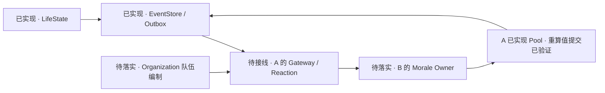
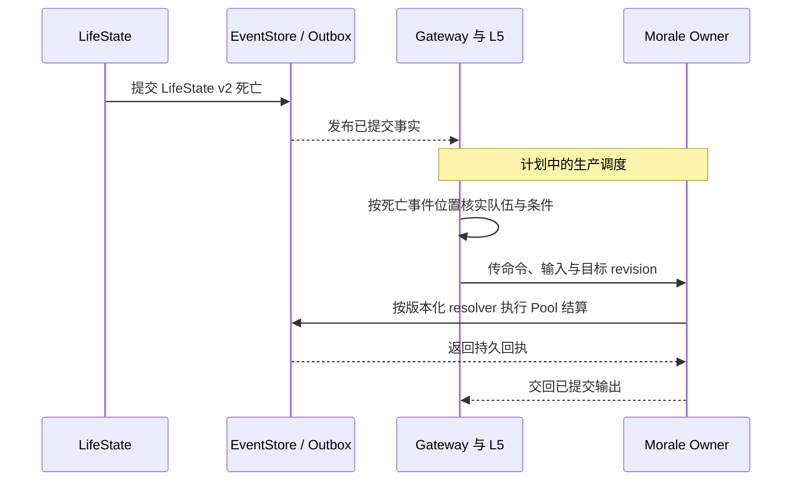
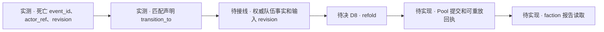

# 守城 Morale 域合同

- 日期 2026-11-23。B 基线 `e5d99c2f87a24e9f089bb637490cb4b2ce57f0e9`，integration `810a46c1249918c09b42fa1fe0c12d7d784579d2`，A 编译器和 Pool `691792c72c65335dedfdf0030a5ab6f6c04fcd24`。
- 状态为触发合同已验证，Morale 生产写入阻塞。待决来源见 Architecture v2《待决清单》D8 和《迁移规格》§七 D7/D8/D10。

## A 可消费的声明

[reaction-probe.json](reaction-probe.json) 可传给 A 的 `compile_reactions`。调用方需要将 `command_fact_outputs` 的数组转换为 `frozenset`。`morale.recompute_morale` 是命令目录的候选名，正式注册须由 Gateway 确认 `Morale` 的 domain。声明保留规范中的 `morale_relevant_casualty@1` 和 `group_of(subject)`。探针以 `fact:unit:gate-east:morale` 为可信输出样例，生产登记应提供实际授权的具体 FactType。A 的编译器拒绝在可信输出集合使用 `fact:unit:*:morale`。

| 对象 | 合同 |
|---|---|
| 死亡输入（已存在） | 从已提交回执的事件 ID 在 EventStore 读取 `gameplay.character.life_state_changed` v2。要求 `to_state == "dead"`。读取 `actor_ref`、`event_id`、`stream_id`、`stream_revision`。总线传递的域字段位于 `payload["committed_payload"]`。 |
| 队伍目标（待定） | Organization 负责军队编制。以死亡事件的提交位置查询有效的队伍成员关系，携带来源流与 revision，供条件和目标解析共用。缺少可核实归属时结果为 unknown，待补齐依据。 |
| Morale 命令（候选） | `morale.recompute_morale` v1 由 `Morale` 唯一处理。参数供处理方按 ID 回读死亡事件和已提交的队伍依据。由调用方提供目标 Pool revision 和输入 revision。重复派发应保留原命令身份，同一死亡事件和目标 scope 应收敛到同一命令身份。幂等合同由 A 的 Gateway 与域处理方对齐。 |
| 队伍士气（候选） | 按《FactType 完整 schema》的队伍实例，原语为 Pool，identity 为 collection，聚合为 distribution，refold 引用 `morale_refold@1`，排序在 LifeState 之后。可见性为 faction，获知渠道为 report。结果将由 Morale 授权并由 Pool 提交，回执附已提交事件 ID 和 revision。A 负责可信输出登记。 |

事实边界来源为《Owner 定义》§正式 Owner 名单、《守城 Demo 定义》§二.1 和《FactType 完整 schema》§队伍士气。事件与 outbox 来源见 [LifeState 写入](../../../backend/app/gameplay/life_state_runtime.py#L214) 与 [dispatcher](../../../backend/app/gameplay/dispatcher.py#L102)。

## 生产依赖

1. **队伍成员权威。** `OrganizationAuthority.record_schedule` 写 `gameplay.organization.membership_recorded`，其 payload 来自班表录入，包含角色、班次和工单。该入口可证明工作组织成员关系。军队编制、死亡时点的唯一队伍目标及来源 revision 仍需可重放的正式来源。Organization 另有提交 `gameplay.organization.membership_delegation_recorded@1` 的包绑定入口，其成员状态包括 active、suspended、revoked。可评估用它承接受控队伍名单，还需要正式守军组织及角色定义、有效性与多归属规则。Population roster 仅记录角色集合。见 [班表写入](../../../backend/app/gameplay/organization_government_runtime.py#L5553)、[委派写入](../../../backend/app/gameplay/organization_government_runtime.py#L6921) 与 [人口 roster](../../../backend/app/population_continuity/roster.py#L13)。
2. **D8 模型。** 《聚合与精度》规定重新折算，D8 留待确定输入及算法。可先评审守城限定的最小模型，按权威队伍名单和已提交的生死事实重算存活比例。固定四人名单的候选对照为 4 人存活得 100，首次确认一人死亡得 75，重复投递结果仍为 75。成员关系或生死输入缺失时为 unknown。这个候选只衡量伤亡压力，训练、军旗及指挥因素留给完整模型。数值口径和名单事实均待立项裁定。
3. **Pool 与 Gateway。** A 的 `pool_runtime.py:71–110` 中 `aggregate_pool_values` 仅接收 split、merge、fidelity_change、scope_change。实测 casualty 被拒绝。现有 `PoolAuthorityService.adjust` 可承接 Morale Resolver 输出。处理方在已读 Pool revision 上计算 `delta = 重算结果 − 当前值`，提交时传 `model_ref` 和 `input_revision_vector`。独立探针证实 `100 → 75` 持久化并可全量重放，重复调用返回原提交，过期来源 revision 拒绝且无新写入。适配的输入来自已提交事实，规则仍由 D8 确定。Pool 现有事件按 authority_only 写入，faction 经报告获知需要对应读取路径。生产路由、提交后触发与可信输出登记依赖 H-A-011 和 H-A-015。

## 体系结构

## 时序

## 数据流

## 验证

- 在 B worktree 用 Python 3.12.2 核验 `app.__file__` 后运行 3 条外部定向探针和仓库既有的 LifeState 图投影测试。结果为 `4 passed, 2 warnings in 0.40s`。外部探针读取固定 A 提交的 `l5_reaction.py` 并复用 B 的真实死亡提交、outbox 和总线。覆盖声明匹配、缺失可信命令输出拒绝、通配输出拒绝。命令为 `python -B -m pytest -q -p no:cacheprovider --basetemp <F盘输出目录>/pytest-tmp -o pythonpath=backend/tests <F盘输出目录>/test_siege_morale_contract.py backend/tests/test_life_state_case_death_caller.py::test_committed_life_state_event_reaches_registered_graph_projector`。
- 在 A worktree 用同版本 Python 调用 `aggregate_pool_values`。`scope_change` 返回测试预期值，`casualty` 抛 `pool_refold_trigger_invalid`。另在 A worktree 运行 `python -B -m pytest -q -p no:cacheprovider --basetemp <F盘输出目录>/pool-pytest-tmp <F盘输出目录>/test_morale_pool_bridge.py backend/tests/test_pool_runtime.py::test_pool_model_adjustment_persists_and_checks_its_input_revision_vector`，结果 `2 passed, 2 warnings in 0.33s`。探针直接提交测试 LifeState 事件以检验 Pool 的 CAS 读集，`75` 是注入的测试结果。原始探针、环境、提交和输出目录为 `F:/paralls-verification/thread-b/siege-morale-20261123-contract/`。
- 生产验收需要实际队伍事实、一次死亡引发一次 Morale 提交、重投与并发幂等、过期 revision 拒绝、全量回放和 checkpoint + tail 一致、阵营报告可见性。当前无新增 Morale 持久事件，Morale 的 P-3、基线选集、全量、生产 Demo 均待后续生产提交验证。
