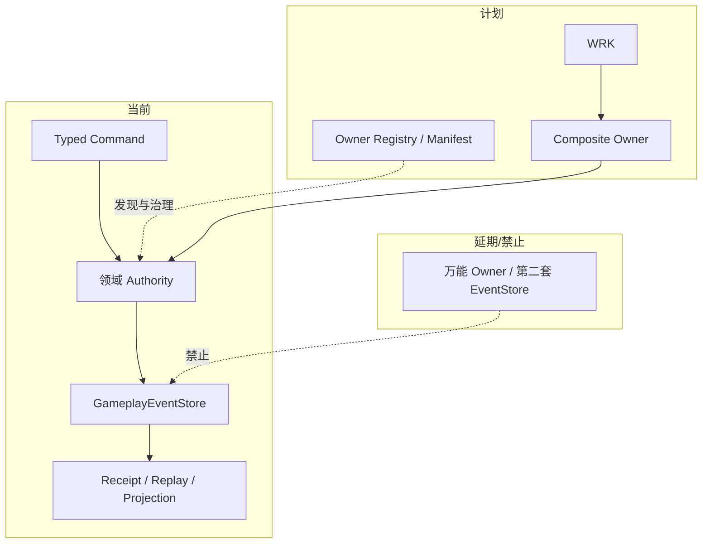
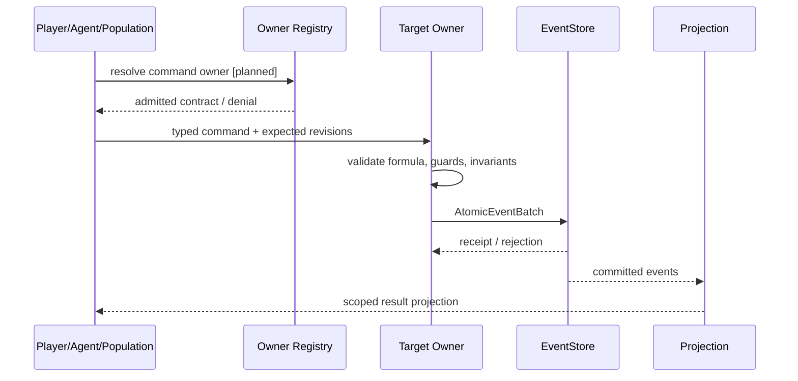
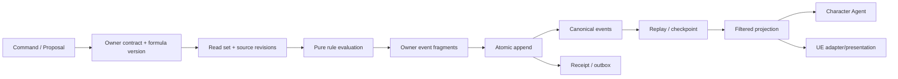

# Owner 分类、注册与当前实现对照

状态：`current implementation mapping; owner taxonomy and registry planned`

## 1. 核心定义

Owner 对一组 canonical facts 负责，至少必须提供事实模型、公式/条件模型、Command 入口、前置条件校验、不变量、revision、幂等、事件提交、receipt、回放和投影。模块名称、文件位置或是否被角色调用，都不能单独证明 Owner 身份。

原子性和基础性是两个维度：

- `Foundation Owner`：被多个领域依赖的基础事实，例如身份、时间、空间、权限和归属。
- `Atomic Owner`：最小独立不变量和事实提交边界，例如库存、身体生命、装备、状态效果。
- `Composite Owner`：编排一个玩法过程，例如生存、战斗、生产、运输和守城；它可以提交跨域候选或 Owner fragments，但不吞并下层事实。

## 2. 当前 Paralls 对照

| 分类 | 建议责任 | 当前实现对照 | 判断 |
| --- | --- | --- | --- |
| 基础设施内核 | EventStore、schema、revision、幂等、receipt、outbox、replay、checkpoint | `backend/app/gameplay/event_store.py`、`replay.py`、`event_schema_registry.py` 等 | `[current]` 已有共享脊柱，不是玩法 Owner |
| Foundation | 时间、实体身份、空间占用、能力/权限、归属/容器 | 有局部 identity、spatial、ownership、capability 运行时；全域时钟/实体 Owner 仍不完整 | `[current]/[planned]` |
| Atomic: resource/body | 资源条目、预留/消耗、伤势、身体功能和动作成本 | `resource_body_runtime.py` 已有投影、reservation、injury、revision、幂等和窄动作结算 | `[current]` 窄纵切，不等于完整生理系统 |
| Atomic: inventory/equipment | 容器、负重、装备关系、耐久 | `inventory_runtime.py`、`equipment_runtime.py` | `[current]` 已有 authority slice |
| Atomic: status/effect | 状态实例、生命周期、叠层、过期和解除 | `status_tags.py`、`semantic_authority.py`、`survival_runtime.py` 有局部状态生命周期 | `[current]` 局部闭环，完整条件模型仍需收口 |
| Atomic: ability/affordance | 能力定义、动作可行性和技能门槛 | `ability_runtime.py`、`skill_action_gate.py`、`character_agent/skills/*` | `[current]` advisory/authority 边界已存在 |
| Atomic: relationship/morale | 社会关系、士气、服从、影响力 | 有社会/空间和角色心智相关局部路径；完整组织士气 Owner 尚未完成 | `[planned]` |
| Composite: survival/combat/production/logistics | 组织多 Owner 的玩法过程 | Survival 有 `NeedState`、tick、`ConsumptionPlan` 和状态效果；construction/production 有较大纵切；完整战斗、运输和守城组合仍分散 | `[current]/[planned]` |

当前 Gameplay 文档已经明确：各 authority 各自构造并验证事件，EventStore 不是万能 coordinator；新增跨域 adapter 必须先进入正式设计和验证。[GameplayFoundation 与领域结算](../运行时/模块/GameplayFoundation与领域结算.md)

## 3. Owner 注册表目标

`[planned]` 需要一个统一 `OwnerManifest`/`OwnerRegistry`，但它不能变成任意调用者自助注册事实的万能接口。每个已接纳 Owner 应声明：

```text
owner_ref
owner_kind: foundation | atomic | composite
canonical_facts
stream_patterns
command_types
formula_refs / condition_refs
owned_events
invariants
projection_contracts
authority_mode: ue_local | canonical_backend | hybrid
latency_budget / prediction_policy
workflow_capabilities
dependencies
failure_codes / replay_policy
```

注册表只负责发现、校验和治理；事实仍由 Owner 自己验证并提交。

## 4. 架构图



## 5. 关键时序图



## 6. 数据流图



## 7. 当前缺口与验收

`[planned]` 的最小收口不是重写现有 authority，而是为现有 Owner 补 Manifest、公式/条件引用、输入依赖和 projection contract，并用一个跨域场景证明成功、拒绝、幂等、revision 冲突、回放和过滤投影。`[deferred]` 不新增第二个 event store、通用任意写入器或通过模型输出直接创建事实 Owner。
