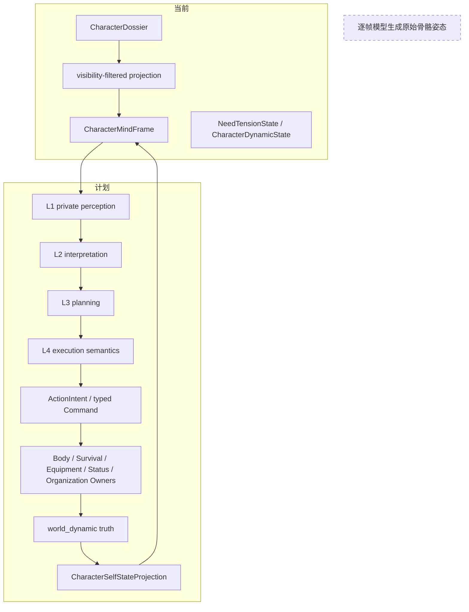
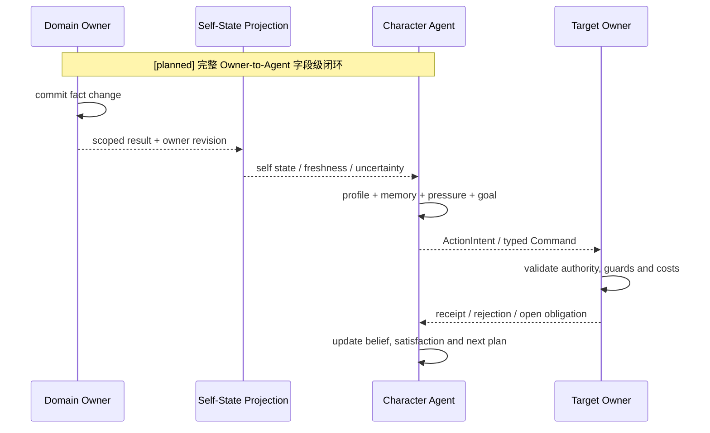
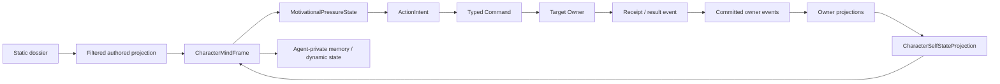

# 角色档案、状态与 Owner 对接

状态：`current character-mind boundary; field-level alignment planned`

## 1. 三个命名空间

角色数据必须分为三类，不能用一个 `DynamicState` 统称：

| 命名空间 | 内容 | 写入者 | 角色智能体用途 |
| --- | --- | --- | --- |
| `authored_static` | 身份、人格、价值观、动机优先级、身体基线、能力/关系种子 | Dossier/content；需要成为运行事实时由对应 Owner 接纳 | 稳定设定和决策偏置 |
| `world_dynamic` | 生命、体力、饥饿、疲劳、伤势、装备耐久、位置、库存、实时士气和关系事实 | 对应 Gameplay Owner | L1 的权威事实投影 |
| `agent_private` | 信念、主观体感、解释、目标、动机冲突、记忆写回 | Character Agent 私有运行时 | L2/L3/L4 决策输入和输出 |

`CharacterDossier` 的 raw 内容不能直接进入 L2/L3/L4，必须经过 audience/visibility projection。`relationship_seed_profile` 和 `capability_seed_profile` 当前明确是 `candidate_only`，不能仅因档案存在就成为 live relationship 或有效能力。[角色智能体](../运行时/模块/角色智能体.md)

## 2. 两类需求必须改名

| 语义 | 推荐名称 | 例子 | Owner/维护者 |
| --- | --- | --- | --- |
| 客观生理指标 | `SurvivalMetricState` | `energy_reserve`、`hydration_reserve`、`fatigue_value` | Survival/Body Owner |
| 指标定义和公式 | `SurvivalMetricDefinition` | 衰减率、范围、单位、阈值引用 | Survival Owner / Rule Registry |
| 阈值条件/持续效果 | `PhysiologicalCondition` / `StatusEffect` | `condition:hunger`、`effect:starvation` | Status/Effect Owner |
| 主观动机压力 | `MotivationalPressureState` | `physiological_pressure`、`safety_pressure` | Character Agent 心智运行时 |
| 静态动机偏好 | `MotivationalPriorityProfile` | 生理、职责、荣誉权重 | Character Dossier |
| 补充缺口的领域计划 | `DeficitRecoveryPlan` | 需要一份食物，需 inventory/ownership 协作 | Survival Composite / Owner fragments |
| 角色准备做什么 | `ActionIntent` | `eat`、`request_ration`、`continue_guard` | Character Agent |

关系是：

```text
SurvivalMetricState
  -> threshold rule
PhysiologicalCondition / StatusEffect
  -> scoped self projection
Character Agent + MotivationalPriorityProfile + memory/context
  -> MotivationalPressureState
  -> ActionIntent
```

`NeedState`、`NeedTensionState` 等旧名可以保留兼容解析，但新文档和新接口不应继续扩大歧义。

## 3. 静态档案接入 Owner

静态档案不直接写 Gameplay truth：

- 人格、价值观、动机优先级影响角色解释和规划，不直接修改生命、库存或公式。
- 体型、年龄、先天体质等身体基线，只有在 Body/Survival Owner 声明为公式输入并固定版本后，才参与计算。
- 职位、权限、职责必须由 Identity/Organization/Capability Owner 接纳，档案文字不能自行授予权限。
- 关系和能力种子先进入对应领域的候选接纳流程，返回 receipt 后才成为运行事实。
- `EmbodimentProfile` 影响表现和物理可行性投影；热更新不能覆盖已有 injury、fatigue、pain 等运行事实。

## 4. 动态状态接入 Owner

正确的闭环是：

```text
Owner committed truth
  -> source_owner + source_revision + captured_at + freshness
  -> CharacterSelfStateProjection / SelfStateNormalizer
  -> L1 private perception
  -> L2 interpretation
  -> L3 plan
  -> L4 execution semantics
  -> ActionIntent / typed Command
  -> target Owner settlement
  -> receipt and new projection
```

角色侧 `CharacterDynamicState` 主要保存 affect、tension、motivation；它不是生命、饥饿或护甲耐久的总状态。`NeedTensionState` 也不是饥饿计量表，而是角色根据事实、档案、记忆、关系和目标形成的主观压力。[角色智能体](../运行时/模块/角色智能体.md)

### 进食示例

```text
Survival Owner：energy_reserve 下降
Status Owner：派生 condition:hunger
Character Agent：判断吃、请求配给、忍耐、偷取或继续执勤
Inventory Owner：检查归属、位置、预留和消耗
Survival Owner：接受营养结果并恢复指标
Character Agent：收到结果，更新主观满足/挫败和下一步策略
```

系统不能仅因阈值低就自动扣粮，除非明确存在被组织政策或失能护理流程授权的自动行为 Command。

### 受伤示例

```text
Combat/ESM：产生命中证据或交互结果
Body Owner：生命、部位功能、伤势数值变化
Equipment Owner：护甲耐久变化
Status Owner：根据条件生成 bleeding / impaired / critical
Character Agent：读取权威投影和主观体感，决定撤退、求医或继续
```

标签是查询和投影载体；持续效果必须有实例、来源、强度、层数、生命周期和可回放结算。

## 5. 架构图



## 6. 时序图



## 7. 数据流图



## 8. 当前缺口

Paralls 已有 dossier projection、`CharacterDynamicState`、`NeedTensionState`、`SelfStateNormalizer` 和多类 Gameplay projection，但统一 `CharacterSelfStateProjection` 的资源字段、Owner source revision、freshness、冲突和完整动作反馈仍是 `[planned]`。下一步应先建立字段级对齐表，再用进食、受伤、命令服从三个案例验收。
