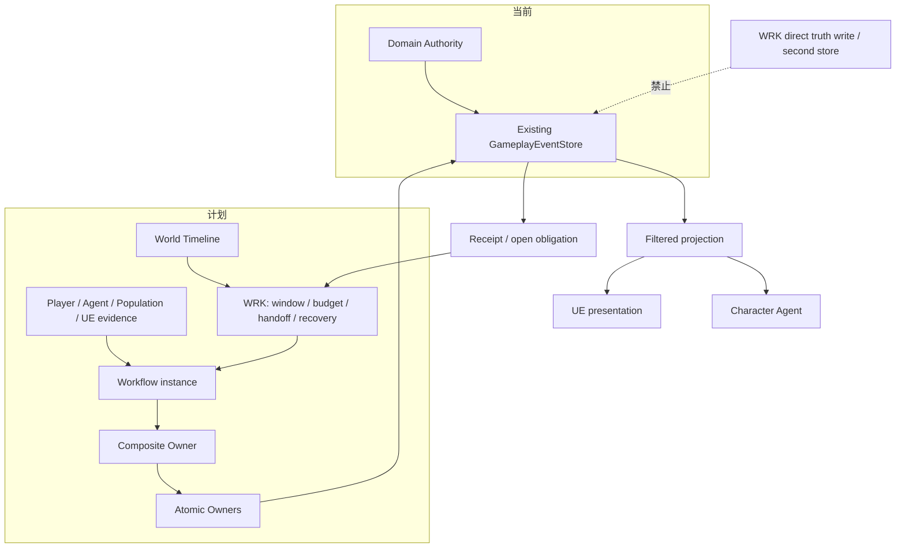
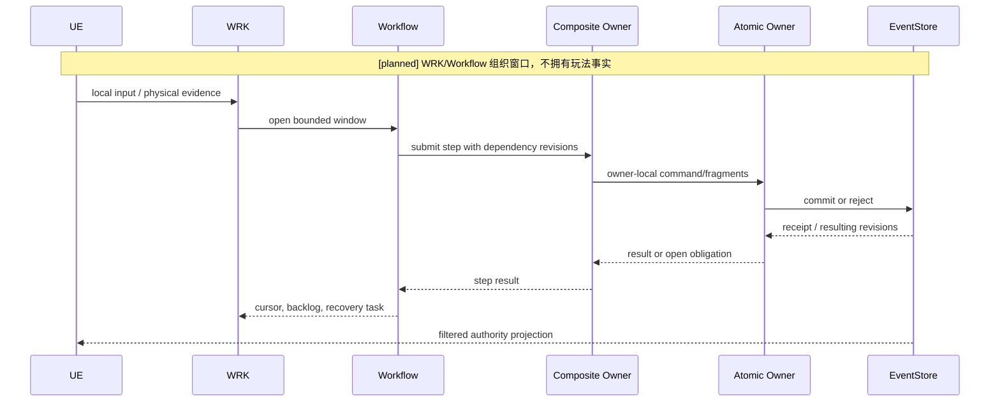
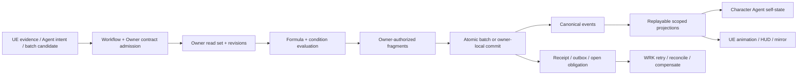

# 规则结算、跨 Owner 协作与 UE-WRK 边界

状态：`current settlement spine; cross-owner coordinator and WRK integration planned`

## 1. 规则模型

公式和条件模型属于对应领域 Owner，不属于角色智能体、UE 蓝图或 WRK。规则应注册为版本化、可回放的纯计算输入：

```text
Guard       是否允许执行
Formula     数值如何变化
Trigger     何时触发
Transition  状态如何进入/叠加/解除
Effect      触发后产生的持续或即时结果
```

每次结算至少固定：

```text
formula_ref / formula_revision
condition_ref / condition_revision
input_revision_vector
previous_value / delta / next_value
causation_id / correlation_id
```

例如流血不是一个裸字符串：它是由伤害结果触发的 `StatusEffect` 实例，拥有来源伤口、严重度、层数、tick 策略、结束条件和可回放事件；`status:bleeding` 只是投影标签。

## 2. 跨 Owner 协作

### 短事务：原子批次

当多个事实需要同一提交边界，可以由 Composite Owner 读取各域 revision，构造受约束的 Owner fragments，再用同一个 `AtomicEventBatch` 提交。每个 fragment 仍声明自己的 Owner principal 和事件范围。

```text
Combat Composite
  -> Body fragment: health / injury
  -> Equipment fragment: armor durability
  -> Status fragment: bleeding
  -> one atomic receipt
```

### 长过程：开放义务和恢复

运输、生产、治疗和守城是长过程，不能假设全局回滚：

```text
start workflow
  -> Owner A commits
  -> Owner B rejects or becomes unavailable
  -> preserve committed facts
  -> open obligation / compensation task
  -> WRK retries, reconciles or closes
```

一个 Owner 失败不能删除另一个 Owner 已提交的历史；补偿只能追加新事实。

### 运输拦截示例

```text
Logistics：创建运输任务并请求 Inventory 预留
Spatial/Threat：提供路线和敌情读集
UE：报告接触/命中证据，不直接改货物
Combat/Logistics：确认拦截结果
Body/Equipment：结算人员伤势和护甲
Inventory：结算货物转移、损失或劫掠
Transport：关闭、失败、逃散或继续
```

## 3. UE 传统实现接入

UE 适合高频和低延迟表现：移动、动画、姿态、镜头、局部碰撞、物理采样、接触点和预测。它不因此拥有生命、库存、生产、运输、伤害结果或状态生命周期。

三种模式必须在 Owner Manifest 声明：

| 模式 | UE 职责 | canonical authority |
| --- | --- | --- |
| `ue_local` | 本地表现、姿态、镜头和非持久预测 | 无玩法事实写入 |
| `canonical_backend` | 提交结构化输入或证据 | Backend/ESM/Gameplay Owner |
| `hybrid` | UE 高频推进，关键接触点提交 | 对应 Owner 在接触/结算边界确认 |

典型战斗链：

```text
UE：刀刃在某帧接触左臂
  -> Combat/ESM：确认命中和伤害
  -> Body：生命/功能
  -> Equipment：护甲耐久
  -> Status：流血/硬直
  -> UE：播放受击、流血和硬直表现
```

## 4. Workflow 与 WRK

`Workflow` 是一个跨 Owner 过程定义及其运行实例；`WRK`（World Runtime Kernel）负责世界时间、窗口、预算、依赖、批量模拟、群体/角色交接、回执追踪和恢复。二者都不能直接修改 Owner 事实。

```text
Workflow：生产一批箭矢
  -> WRK：安排时间、工坊、依赖、预算和重试
  -> Production：验证配方、设备和工人
  -> Inventory：扣原料
  -> Production：结算半成品/成品
  -> Inventory：成品入库
  -> WRK：汇总 receipt，关闭或保留义务
```

`[deferred]` 禁止新增第二套 EventStore、第二个全局 Clock、万能 Scheduler 或“WRK 直接写事实”的路径。现有 WRK 规格也明确它不是万能事实写入器。[前后架构差异与世界运行内核规格](../../10月中旬分析/群体模拟升级/规格/06-前后架构差异与世界运行内核规格.md)

## 5. 架构图



## 6. 时序图



## 7. 数据流图



## 8. 验收重点

每个新组合玩法至少证明：成功、拒绝、重复命令幂等、revision 冲突、事件回放、过滤投影、Owner 失败后的开放义务和补偿。UE 运行结果只能作为证据或本地状态，除非 Owner Manifest 明确声明 hybrid 的提交边界并由对应 authority receipt 确认。
