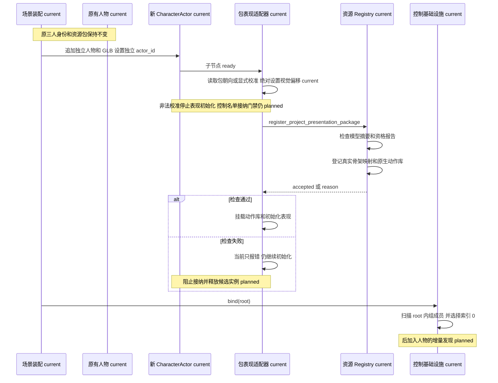
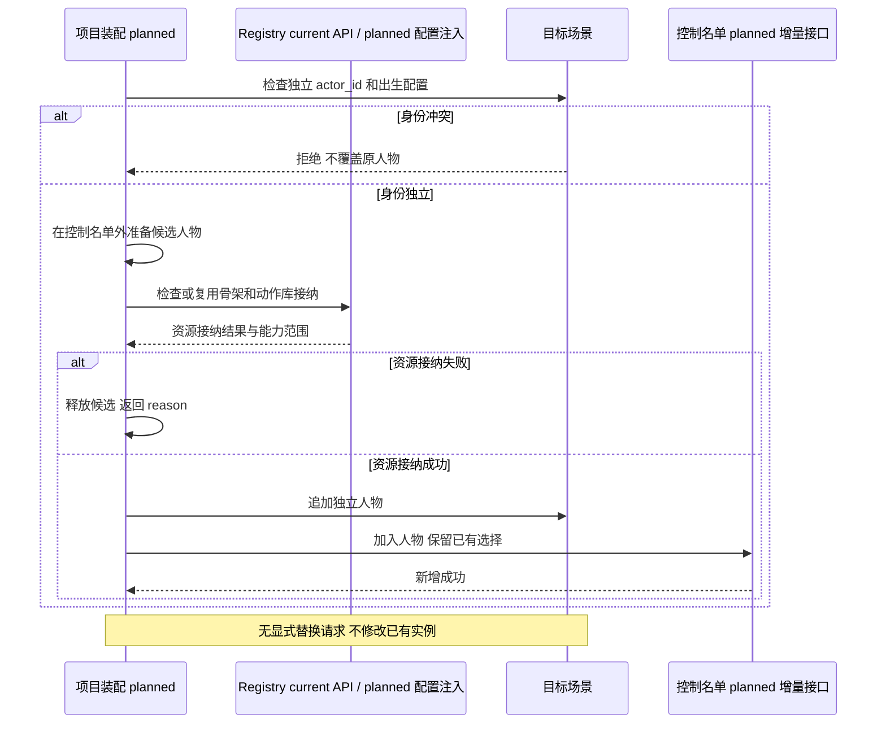

# 角色控制基础设施时序图

## 当前静态追加人物



## 计划的接纳流程



自动批量异骨架重定向为 deferred，不在场景启动时隐式执行。

## 控制执行

```mermaid
sequenceDiagram
    participant Source as Control Source
    participant Foundation as CharacterControlFoundation
    participant Port as CharacterControllerPort
    participant Actor as CharacterActor
    participant Motor as CharacterMotor
    participant Presentation as Presentation Runtime
    participant Authority as Backend Authority

    Source->>Foundation: sample or goal adapter output
    Foundation->>Port: normalize intent
    Port->>Actor: submit control intent
    Actor->>Actor: arbitrate action and update runtime state
    Actor->>Motor: apply movement and root contribution
    Motor-->>Actor: motion state / collision result
    Actor->>Presentation: semantic action and state
    Presentation-->>Actor: marker / root contribution
    Note over Actor,Presentation: current 包适配器转 Actor 本地 delta Actor 再转世界 视觉校准只应用一次
    Actor->>Authority: structured world-changing request (when needed)
    Authority-->>Actor: authority result or rejection
    Actor->>Presentation: hit / recovery / confirmed result
```
